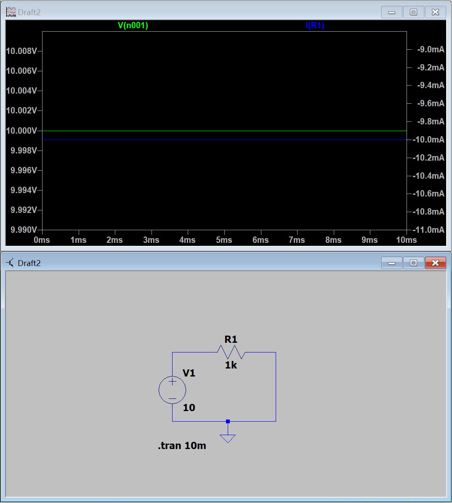
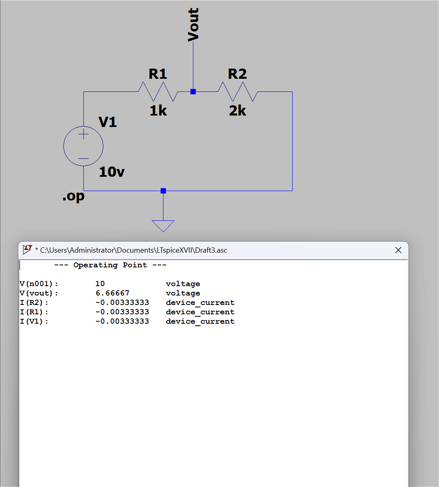

# Day 1｜电学基础与 LTspice 入门

- 日期：2026-11-03
- 对应阶段：A｜电学第一性原理 + LTspice 入门
- 当日状态：理论与仿真验收通过，实物操作待补

## 一、当天完成情况

| 项目 | 状态 | 结果 |
|---|---|---|
| 电学基础概念 | 已完成 | 能解释电荷、电场、电压、电流、功率、能量和接地 |
| 单电阻 LTspice 仿真 | 已完成 | 10 V、1 kΩ、10 mA、0.1 W |
| 双电阻串联仿真 | 已完成 | Vout = 6.66667 V，I = 3.33333 mA |
| 闭卷测验 | 已通过 | 订正后 8/8 |
| 万用表与元件识别 | 待补 | 暂缺设备，未形成实测证据 |

## 二、核心概念

### 1. 电荷与电场

电荷是带电粒子具有的电磁属性，分为正电荷和负电荷。同种电荷相斥，异种电荷相吸。

电荷会在周围产生电场，电场中的其他电荷会受到电场力。电场强度定义为单位电荷受到的力：

```text
E = F / q
```

其中：

- E 是电场强度；
- F 是电荷受到的电场力；
- q 是试探电荷的电荷量。

电场强度是矢量，单位是 V/m。

### 2. 电压、电位与参考地

电位是某一点相对于参考零电位的电势状态。更严谨地说，电位是单位正电荷从参考点移动到该点时具有的电势能：

```text
VA = W(参考点→A) / q
```

电压是两个点之间的电位差：

```text
UAB = VA - VB
```

电位和电压的单位都是伏特：

```text
1 V = 1 J/C
```

接地通常表示选定电路中的 0 V 参考点，不一定表示真正连接到大地。改变参考点会改变各节点的电位数值，但不会改变两点之间的电压差、电流或功率。

### 3. 电流

电流表示单位时间内通过某个截面的电荷量：

```text
I = dQ / dt
```

单位是安培：

```text
1 A = 1 C/s
```

工程中采用传统电流方向，即正电荷的等效流动方向。金属导体中电子实际运动方向通常与传统电流方向相反。

电流的正负号取决于预先选定的参考方向：

- 实际电流与参考方向相同：电流取正；
- 实际电流与参考方向相反：电流取负。

### 4. 理想电压源与电流源

- 理想电压源约束端口电压，电流由外部电路决定；
- 理想电流源约束支路电流，端口电压由外部电路决定；
- 理想电压源置零后相当于短路；
- 理想电流源置零后相当于开路。

### 5. 功率与能量

功率表示能量传递或转换的快慢：

```text
P = V × I
```

单位瓦特的物理意义是焦耳每秒：

```text
1 W = 1 J/s
```

能量等于功率对时间的累积：

```text
W = P × t
```

功率描述速率，能量描述一段时间内传递或消耗的总量。

## 三、LTspice 实验

### 实验一：单电阻电路

电路参数：

- 直流电压源：V1 = 10 V
- 电阻：R1 = 1 kΩ
- 电源负极接地

仿真结果：

- 节点电压：V(n001) = 10 V
- 电阻电流大小：10 mA
- 电阻功率：

```text
P = V × I = 10 V × 0.01 A = 0.1 W
```

由于电路只包含理想直流电源和电阻，因此在暂态仿真中电压和电流一直保持常数。



源文件：

- [单电阻暂态仿真](simulations/day01-single-resistor-tran.asc)
- [单电阻工作点仿真](simulations/day01-single-resistor-op.asc)

### 实验二：双电阻串联电路

电路参数：

- 直流电压源：V1 = 10 V
- 上方电阻：R1 = 1 kΩ
- 下方电阻：R2 = 2 kΩ
- 两电阻之间节点：`Vout`
- 使用 `.op` 直流工作点分析

理论计算：

```text
I = 10 V / (1 kΩ + 2 kΩ)
  = 3.333 mA

Vout = I × R2
     = 3.333 mA × 2 kΩ
     = 6.667 V

V(R1) = 10 V - 6.667 V
      = 3.333 V
```

LTspice 仿真结果：

- V(n001) = 10 V
- V(vout) = 6.66667 V
- I(R1) = -3.33333 mA
- I(R2) = -3.33333 mA
- I(V1) = -3.33333 mA

仿真与手算一致，验证了：

- 串联电路中两个电阻的电流大小相同；
- 串联电压满足 V(R1) + V(R2) = 10 V；
- 电阻越大，分得的电压越大；
- 电流负号只表示 LTspice 参考方向与实际电流方向相反。

功率核对：

```text
P(R1) = I² × R1
      ≈ (3.333 mA)² × 1 kΩ
      ≈ 11.11 mW

P(R2) = I² × R2
      ≈ (3.333 mA)² × 2 kΩ
      ≈ 22.22 mW

P(总) ≈ 33.33 mW
```



源文件：

- [双电阻串联工作点仿真](simulations/day01-series-resistors-op.asc)

## 四、闭卷测验与订正

最终成绩：8/8。当天有两处概念通过订正后掌握。

1. 电压、电流、功率、能量的单位分别是 V、A、W、J。
2. 10 V 接 1 kΩ，电流约为 10 mA。
3. 10 V × 0.5 A = 5 W。
4. 同一电阻两端电压翻倍，根据 P = V² / R，功率变为原来的四倍。
5. 电位是单点相对于参考零电位的值，电压是两点之间的电位差；电压不是“电场强度的压差”。
6. 电流正负号由参考方向决定；传统电流方向与金属中电子实际运动方向相反。
7. 串联电路电流相同，本质是稳态下电荷守恒，不会在普通导线或电阻中持续堆积。
8. 接地是电路中的 0 V 参考，不等于电荷全部流入大地。真实保护接地还具有安全泄放作用。

## 五、LTspice 操作总结

- `.tran` 用于暂态分析，结果通常显示在波形窗口；
- `.op` 用于直流工作点分析，结果通常显示为节点电压和支路电流列表；
- `.op` 弹出的文字窗口是正常输出，不是报错；
- `device_current` 表示器件电流，不是错误信息；
- 器件电流为负时，应结合预设参考方向解释，不能直接认为物理量为负；
- 只有电源和电阻的直流电路在 `.tran` 中显示水平线是正常现象；
- 使用节点标签可以提高原理图可读性，例如把中间节点命名为 `Vout`。

## 六、待补实物操作

以下项目暂因设备条件无法完成：

- 万用表通断档、电阻档和电压测量练习；
- 电阻、电容和电感的实物识别；
- 面包板或焊接练习；
- 真实低压电路测量。

待补操作必须写明真实测试条件。设备到位前不填写模拟数据，也不把未操作项目标记为已实测。

建议在 Day 12–13 的低压器件实验前补齐基础测量工具，在 Day 33–35 的仪器测试前准备限流直流电源和示波器。若无法获得这些设备，则只能完成仿真与设计路线，最终作品集中不能声称已有实测证据。

## 七、Day 1 结论

Day 1 的理论、仿真和闭卷测验已经通过，具备继续学习电阻网络与戴维南定理的基础。实物测量部分保留为待补项，不影响进入 Day 2，但必须在后续项目阶段补回。

下一日主题：电阻网络、KCL/KVL 与戴维南定理。
