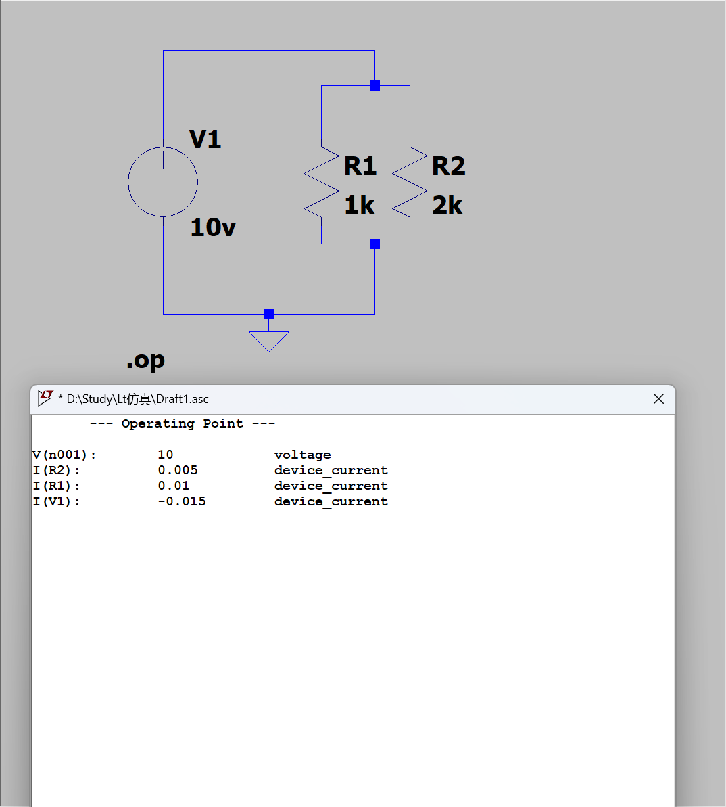
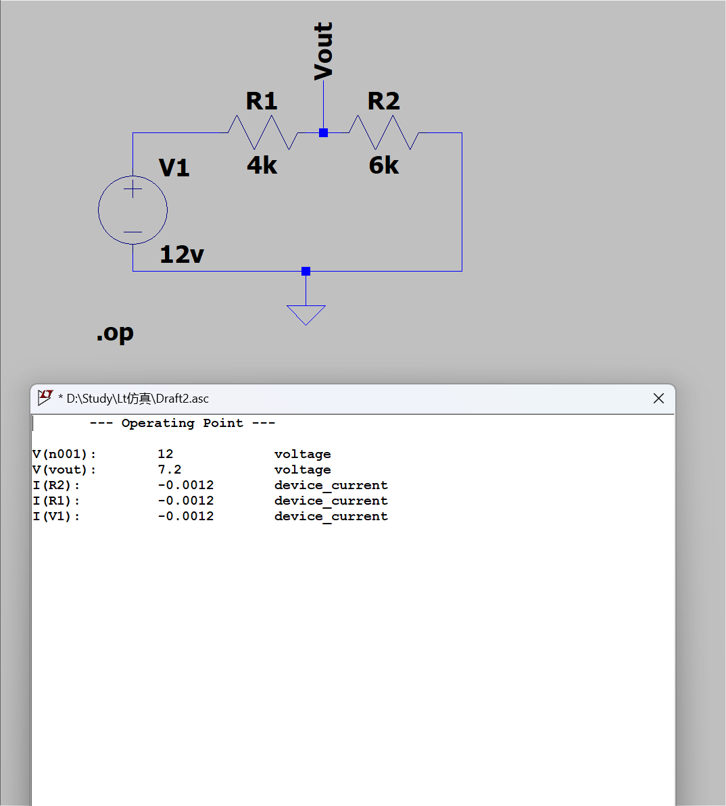

# Day 2｜欧姆定律、混联网络与 LTspice 验证

- 日期：2026-11-03
- 对应阶段：A｜电学第一性原理 + LTspice 入门
- 当日状态：已完成
- 学习边界：本日不包含戴维南定理

## 一、当天完成内容

| 项目 | 状态 | 结果 |
|---|---|---|
| 欧姆定律与功率 | 已完成 | 能完成电压、电流、电阻和功率换算 |
| 串联与并联 | 已完成 | 能计算等效电阻、支路电流和分压 |
| 串并联混合网络 | 已完成 | 先化简并联部分，再与串联部分相加 |
| KCL / KVL | 已完成 | 能根据节点电流和闭合回路检查结果 |
| 电压分压 | 已完成 | 能区分空载与带负载输出 |
| 并联电阻 LTspice 仿真 | 已完成 | 总电流 15 mA，支路电流 10 mA、5 mA |
| 分压电路 LTspice 仿真 | 已完成 | Vout = 7.2 V，主电流 1.2 mA |

## 二、核心公式

### 欧姆定律

```text
V = I × R
I = V / R
R = V / I
```

### 电功率

```text
P = V × I
P = I² × R
P = V² / R
```

### 串联

```text
R总 = R1 + R2
I1 = I2 = I总
U总 = U1 + U2
```

### 并联

```text
1 / R总 = 1 / R1 + 1 / R2

R总 = (R1 × R2) / (R1 + R2)

U1 = U2 = U总
I总 = I1 + I2
```

### 空载分压

```text
Vout = Vin × R2 / (R1 + R2)
```

## 三、练习题结果

| 题号 | 关键结果 | 状态 |
|---|---|---|
| 1 | I = 5 mA，P = 0.1 W | 正确 |
| 2 | I = 2 mA，V(R1)=4 V，V(R2)=8 V | 基本正确，补充总功率 |
| 3 | R总=2 kΩ，总电流 9 mA，P=0.162 W | 正确 |
| 4 | 两个相同电阻各分流 6 mA | 正确 |
| 5 | 总电阻3 kΩ，节点电压8 V | 正确 |
| 6 | Vout=8 V，I=2 mA | 正确 |
| 7 | R下=2 kΩ，Vout=4.8 V，I负载=1.2 mA | 订正后正确 |
| 8 | Ix=5 mA | 正确 |
| 9 | R1=1 kΩ，R2=2 kΩ，V(R2)=10 V | 正确 |
| 10 | 增大 R2 后，输出增大、总电流减小 | 订正后正确 |

首次作答约 7.5/10；订正后全部通过。

## 四、重点题目订正

### 第 2 题：补充总功率

```text
P总 = P1 + P2
    = 8 mW + 16 mW
    = 24 mW
```

也可以直接计算：

```text
P总 = V × I
    = 12 V × 2 mA
    = 24 mW
```

### 第 5 题：串并联混合网络

先求 R2 与 R3 并联：

```text
R并 = R2 ∥ R3
    = (3 kΩ × 6 kΩ) / (3 kΩ + 6 kΩ)
    = 2 kΩ
```

再与 R1 串联：

```text
R总 = R1 + R并
    = 1 kΩ + 2 kΩ
    = 3 kΩ
```

计算结果：

```text
I总 = 12 V / 3 kΩ = 4 mA
V节点 = 12 V × 2 kΩ / 3 kΩ = 8 V
I(R2) = 8 V / 3 kΩ ≈ 2.667 mA
I(R3) = 8 V / 6 kΩ ≈ 1.333 mA
```

检查 KCL：

```text
2.667 mA + 1.333 mA = 4 mA
```

### 第 7 题：带负载分压

本题电源仍然是 24 V。第一次作答误用了 12 V。

负载与 R2 并联：

```text
R下 = R2 ∥ RL
    = 4 kΩ ∥ 4 kΩ
    = 2 kΩ
```

输出电压：

```text
Vout = 24 V × 2 kΩ / (8 kΩ + 2 kΩ)
     = 4.8 V
```

负载电流：

```text
IL = 4.8 V / 4 kΩ
   = 1.2 mA
```

空载时 Vout 为 8 V；加载后下降为 4.8 V。

### 第 10 题：电阻增大后的变化

初始状态：

```text
R总 = 1 kΩ + 2 kΩ = 3 kΩ
I = 10 V / 3 kΩ ≈ 3.333 mA
Vout = 10 V × 2 kΩ / 3 kΩ ≈ 6.667 V
```

将 R2 从 2 kΩ 增加到 3 kΩ：

```text
R总 = 1 kΩ + 3 kΩ = 4 kΩ
I = 10 V / 4 kΩ = 2.5 mA
Vout = 10 V × 3 kΩ / 4 kΩ = 7.5 V
```

结论：

- 总电流减小；
- R2 分得的电压增大；
- 输出电压从 6.667 V 增加到 7.5 V。

## 五、LTspice 并联电阻实验

电路参数：

- V1 = 10 V
- R1 = 1 kΩ
- R2 = 2 kΩ
- R1、R2 并联
- 仿真类型：`.op`

工作点结果：

```text
V(n001) = 10 V
I(R1) = 10 mA
I(R2) = 5 mA
I(V1) = -15 mA
```

检查 KCL：

```text
10 mA + 5 mA = 15 mA
```

功率平衡：

```text
P(R1) = 0.1 W
P(R2) = 0.05 W
P总 = 0.15 W
```



源文件：[并联电阻工作点仿真](simulations/day02-parallel-resistors-op.asc)

## 六、LTspice 分压电路实验

电路参数：

- V1 = 12 V
- R1 = 4 kΩ
- R2 = 6 kΩ
- 中间节点：Vout
- 仿真类型：`.op`

工作点结果：

```text
V(n001) = 12 V
V(Vout) = 7.2 V
I(R1) = -1.2 mA
I(R2) = -1.2 mA
I(V1) = -1.2 mA
```

检查 KVL：

```text
V(R1) = 12 V - 7.2 V = 4.8 V
V(R2) = 7.2 V

4.8 V + 7.2 V = 12 V
```

功率检查：

```text
P(R1) = I² × R1 = 5.76 mW
P(R2) = I² × R2 = 8.64 mW
P总 = 14.4 mW
```



源文件：[分压电路工作点仿真](simulations/day02-voltage-divider-op.asc)

## 七、LTspice 方法总结

- `.op` 计算直流工作点；
- 节点电压直接显示为 `V(节点名)`；
- 支路电流显示为 `I(器件名)`；
- 电流负号取决于 LTspice 的器件参考方向；
- 串联电阻电流大小相同；
- 并联支路两端电压相同；
- 计算结果应同时用 KCL、KVL 和功率平衡检查。

## 八、当日结论

Day 2 已完成欧姆定律、串并联、KCL/KVL、分压和两个 LTspice 工作点仿真。串并联化简和分压计算已经掌握，带负载分压的错误已订正。

下一日主题：电容基础、RC 充放电与时间常数。
