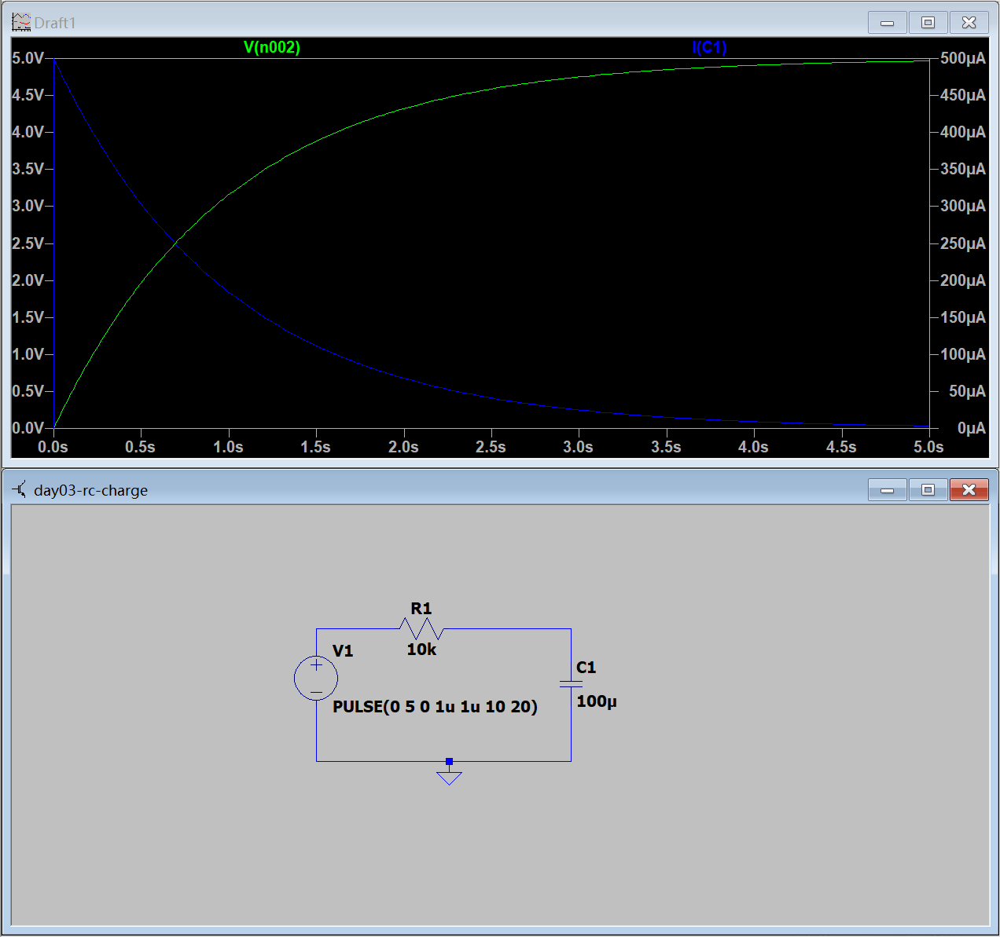
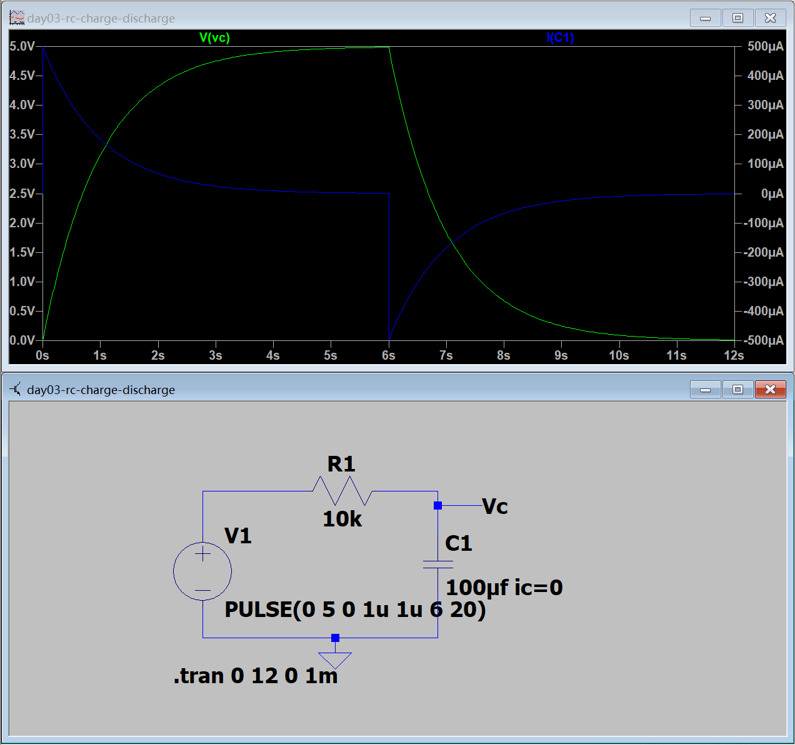
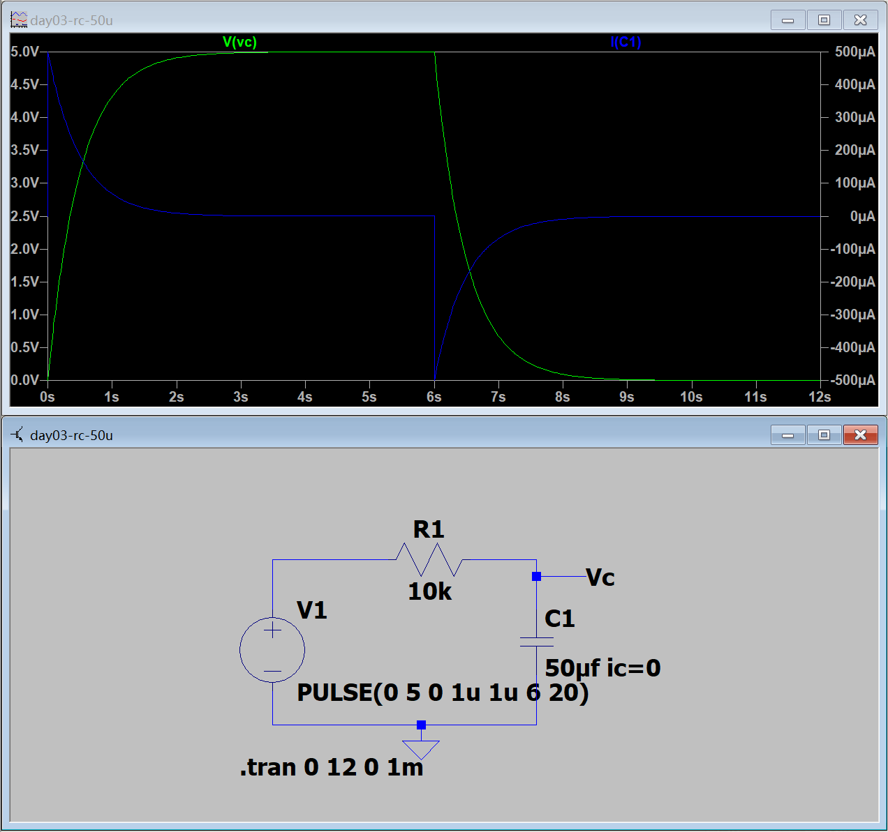
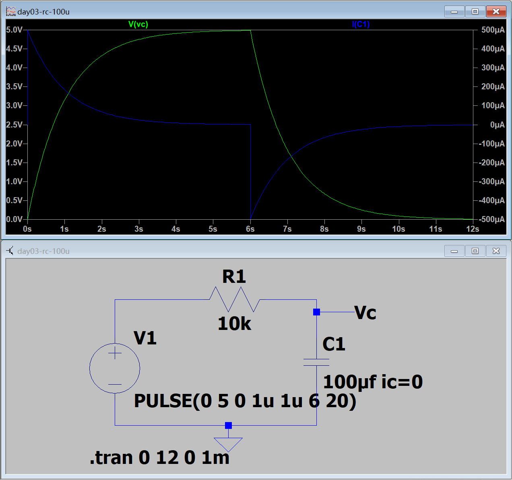
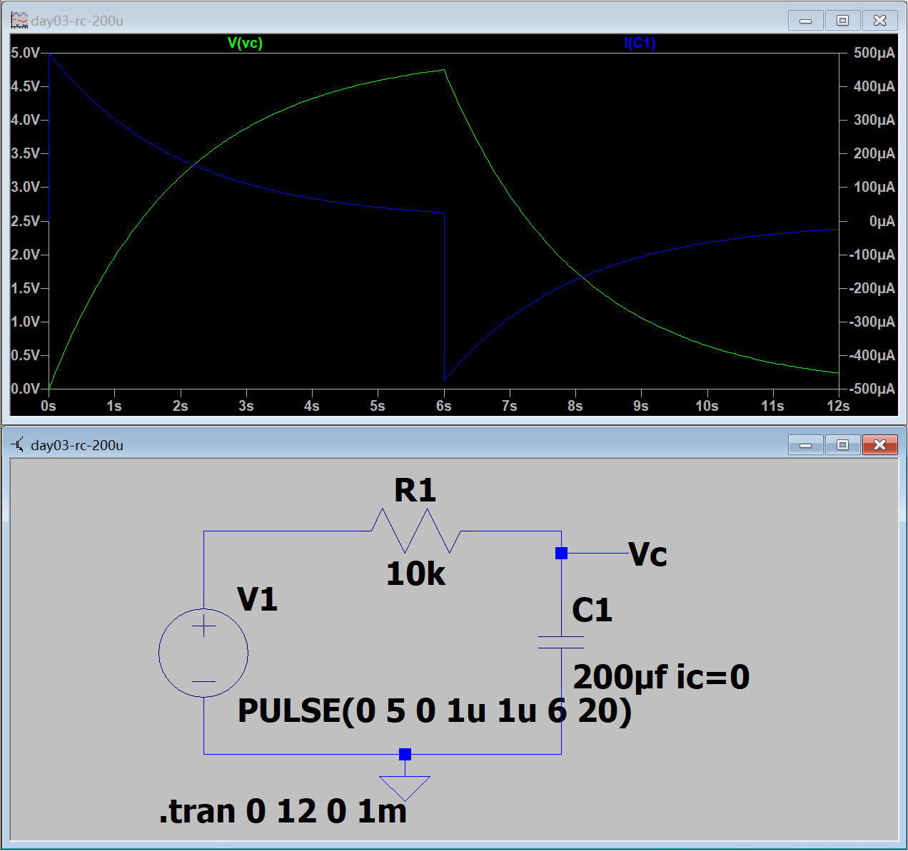

# Day 3｜电容基础与 RC 暂态

- 日期：2026-11-04
- 对应阶段：A｜电学第一性原理 + LTspice 入门
- 当日状态：已完成
- 验收成绩：9/10
- 学习边界：本日不包含戴维南定理

## 一、当天完成内容

| 项目 | 状态 | 结果 |
|---|---|---|
| 电容与电荷关系 | 已完成 | 掌握 Q = C × V 及单位换算 |
| 电容储能 | 已完成 | 掌握 E = 1/2 × C × V² |
| 电容电流关系 | 已完成 | 掌握 i = C × dv/dt |
| RC 充放电 | 已完成 | 掌握时间常数、初态和稳态 |
| RC 公式推导 | 已完成 | 能由 KVL 推导一阶微分方程 |
| LTspice 充电与放电 | 已完成 | 波形和理论值一致 |
| 电容参数对比 | 已完成 | 完成 50、100、200 μF 对比 |
| Datasheet 阅读 | 已完成 | 完成 Samsung MLCC 参数卡 |
| 闭卷测验 | 已通过 | 9/10 |

## 二、核心公式

### 电荷与容量

```text
Q = C × V
C = Q / V
V = Q / C
```

单位：

```text
1 F = 1 C/V
1 μF = 10⁻⁶ F
1 nF = 10⁻⁹ F
1 pF = 10⁻¹² F
```

1 F 的物理意义：电容两端电压改变 1 V 时，储存或释放的电荷量为 1 C。

### 电容电流

```text
i = C × dv/dt
```

结论：

- 电容电压不能瞬间跳变；
- 当电压变化率有限时，电流也有限；
- 电路切换可以导致电容电流瞬间变化；
- 电容电压是连续量。

### 电容储能

```text
E = 1/2 × C × V²
```

### RC 时间常数

```text
τ = R × C
```

单位：

```text
Ω × F
= (V/A) × (C/V)
= C/A
= s
```

## 三、RC 充电公式推导

电压源、电阻和电容串联时，由 KVL：

```text
Vs = V(R) + Vc
```

电阻和电容关系：

```text
V(R) = i × R
i = C × dVc/dt
```

代入：

```text
Vs = RC × dVc/dt + Vc
```

整理：

```text
RC × dVc/dt + Vc = Vs
```

通解：

```text
Vc(t) = Vs + A × e^(-t/τ)
```

初始条件：

```text
Vc(0) = 0
```

得到：

```text
A = -Vs
```

因此充电电压：

```text
Vc(t) = Vs × (1 - e^(-t/τ))
```

对电压求导得到充电电流：

```text
i(t) = Vs/R × e^(-t/τ)
```

## 四、充放电关键数值

使用：

```text
R = 10 kΩ
C = 100 μF
Vs = 5 V
```

时间常数：

```text
τ = 10 kΩ × 100 μF = 1 s
```

初始电流：

```text
i(0) = 5 V / 10 kΩ = 0.5 mA
```

| 时间 | 充电电压 | 放电电压 |
|---|---:|---:|
| 1τ | 3.161 V | 1.839 V |
| 2τ | 4.323 V | 0.677 V |
| 3τ | 4.751 V | 0.249 V |
| 5τ | 4.966 V | 0.034 V |

工程上通常认为经过约 5τ，充放电过程基本完成。

## 五、LTspice 充电实验

电路参数：

- 电压源：PULSE(0 5 0 1u 1u 10 20)
- R1 = 10 kΩ
- C1 = 100 μF
- 仿真时间：0～5 s

结果：

- 初始电压为 0 V；
- 初始电流约为 0.5 mA；
- 1 s 时电压约为 3.16 V；
- 3 s 时电压约为 4.75 V；
- 5 s 时电压约为 4.97 V；
- 电流按指数规律减小到接近 0。



源文件：[day03-rc-charge.asc](simulations/day03-rc-charge.asc)

## 六、LTspice 充放电实验

电源脉冲：

```text
PULSE(0 5 0 1u 1u 6 20)
```

仿真时间：

```text
0～12 s
```

结果：

- 0～6 s：电容充电到约 5 V；
- 6 s 时电源降为 0 V；
- 电容通过电阻放电；
- 放电电流方向与充电电流相反；
- 放电结束后电压和电流均接近 0。



源文件：[day03-rc-charge-discharge.asc](simulations/day03-rc-charge-discharge.asc)

## 七、不同电容值对比

保持 R = 10 kΩ，分别测试：

| 电容 | 时间常数 | 6 s 时相当于 | 6 s 时充电电压 |
|---|---:|---:|---:|
| 50 μF | 0.5 s | 12τ | 接近 5 V |
| 100 μF | 1 s | 6τ | 约 4.97 V |
| 200 μF | 2 s | 3τ | 约 4.75 V |

充电越快排序：

```text
50 μF > 100 μF > 200 μF
```

原因是电容越大，时间常数越大：

```text
τ = R × C
```

三条曲线在各自 1τ 时都应该达到最终值的约 63.2%。

### 50 μF



源文件：[day03-rc-50u.asc](simulations/day03-rc-50u.asc)

### 100 μF



源文件：[day03-rc-100u.asc](simulations/day03-rc-100u.asc)

### 200 μF



源文件：[day03-rc-200u.asc](simulations/day03-rc-200u.asc)

## 八、仿真结论

1. 充电电压呈指数上升；
2. 充电电流呈指数衰减；
3. 电容放电时电流方向反转；
4. 电容越大，充电和放电越慢；
5. 不同容量在各自的 1τ 时刻都达到相同的归一化电压；
6. LTspice 波形与手算公式一致。

## 九、Datasheet 阅读

完成型号：

```text
Samsung CL10B104KB8NNNC
```

主要参数：

```text
容量：100 nF ±10%
介质：X7R
额定电压：50 V DC
封装：0603 / 1608
温度范围：-55 ℃～+125 ℃
DF：≤2.5%
```

直流偏压下的有效容量：

| 直流偏压 | 有效容量 |
|---|---:|
| 0 V | 约 100 nF |
| 10 V | 约 95.56 nF |
| 25 V | 约 72.86 nF |
| 50 V | 约 37.53 nF |

需要记住：

- 标称容量不等于实际工作容量；
- MLCC 的容量会随直流偏压下降；
- 有效容量下降会使 RC 时间常数变短；
- 固定 ESR、绝缘电阻和漏电流在当前资料中没有明确数值，因此不进行猜测。

完整参数卡：

[Samsung CL10B104KB8NNNC Datasheet 参数卡](datasheet-card-samsung-CL10B104KB8NNNC.md)

## 十、闭卷测验

成绩：9/10。

| 题目 | 结果 |
|---|---|
| 1 | 部分正确，1 F 的物理意义需要补充 |
| 2 | 正确 |
| 3 | 正确 |
| 4 | 正确 |
| 5 | 正确 |
| 6 | 正确 |
| 7 | 正确 |
| 8 | 正确 |
| 9 | 正确 |
| 10 | 正确 |

第 1 题订正：

```text
1 F = 1 C/V
```

含义是：电容两端电压改变 1 V 时，储存或释放的电荷量为 1 C。

## 十一、当日结论

Day 3 已完成电容基础、RC 公式推导、LTspice 充放电实验、不同容量对比和一款实际 MLCC 的 Datasheet 阅读。

已经能够：

- 从 KVL 推导 RC 充放电公式；
- 解释电容电压连续、电流可突变；
- 计算时间常数和不同时间点的电压；
- 根据仿真波形判断充放电过程；
- 认识 MLCC 直流偏压对有效容量的影响。

下一日主题：电感、RL 暂态与磁场储能。
