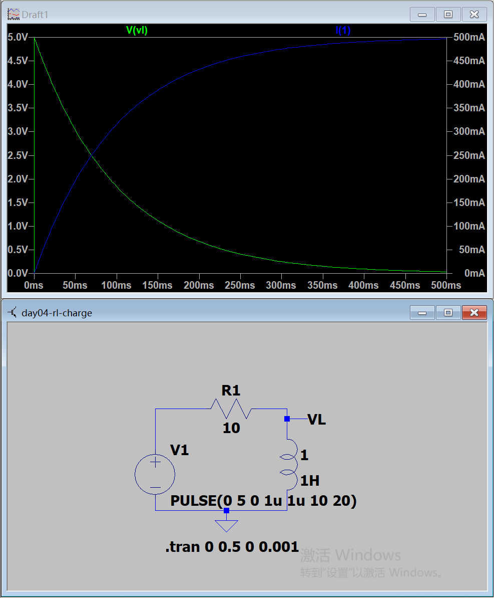
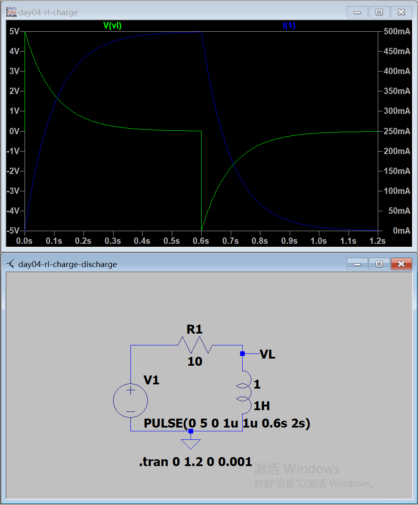
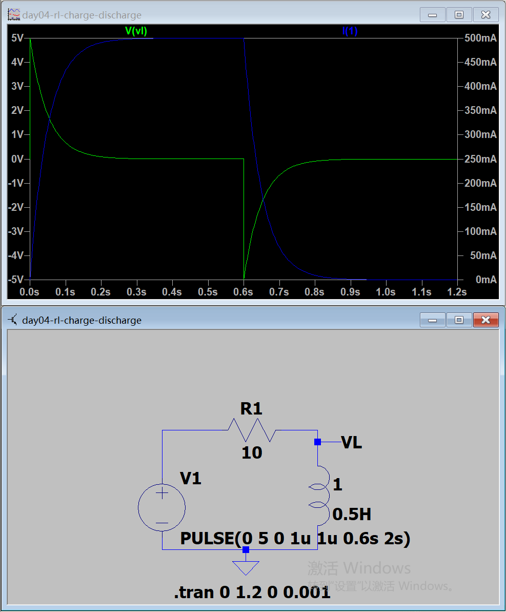
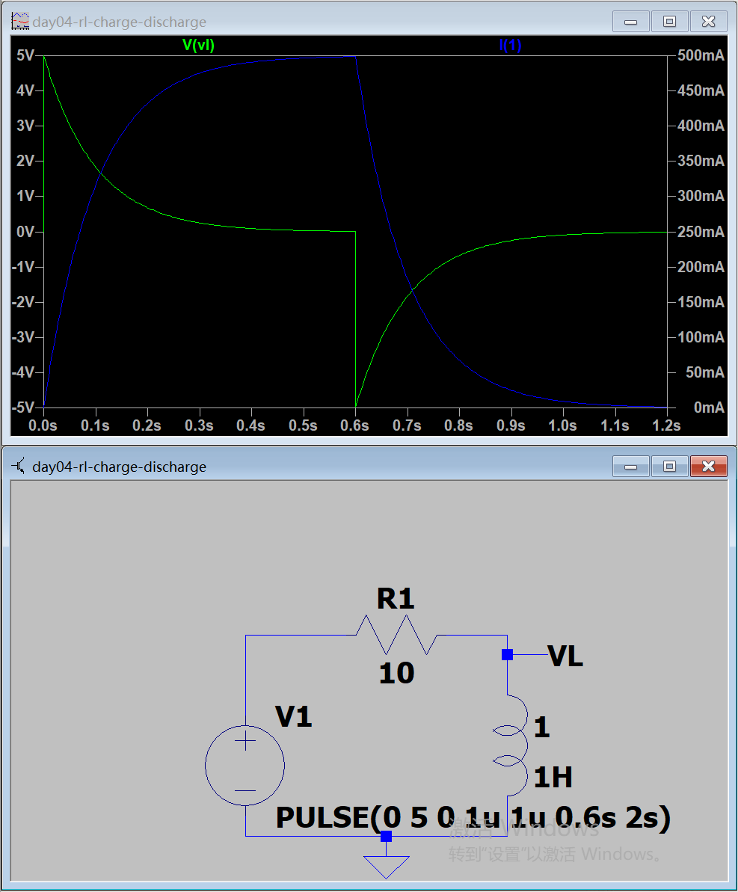
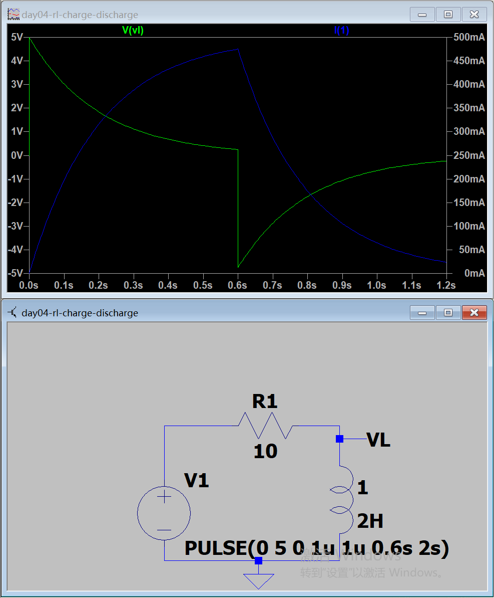

# Day 4｜电感、RL 暂态与磁场储能

- 日期：2026-11-04
- 对应阶段：A｜电学第一性原理 + LTspice 入门
- 当日状态：已完成
- 验收成绩：9.5/10
- 学习边界：本日不包含戴维南定理

## 一、当天完成内容

| 项目 | 状态 | 结果 |
|---|---|---|
| 电感与磁场储能 | 已完成 | 掌握电感电压、储能和单位 |
| RL 电流上升 | 已完成 | 波形与理论值一致 |
| RL 电流衰减 | 已完成 | 理解电感电流连续性 |
| 时间常数 | 已完成 | 掌握 τ = L/R |
| 不同电感值对比 | 已完成 | 完成 0.5、1、2 H 对比 |
| LTspice 仿真 | 已完成 | 5 个工程和 5 张关键截图 |
| 电感 Datasheet | 已完成 | Bourns SRN4018-100M |
| 闭卷测验 | 已通过 | 9.5/10 |

## 二、核心概念

电感描述线圈产生磁通和抵抗电流变化的能力：

```text
L = N × Φ / I
```

单位：

```text
1 H = 1 V·s/A
1 mH = 10⁻³ H
1 μH = 10⁻⁶ H
```

电感两端电压：

```text
vL = L × di/dt
```

1 H 的物理意义：

> 电感电流以 1 A/s 的速度变化时，电感两端产生 1 V 的感应电压。

需要记住：

- 电感电流不能瞬间跳变；
- 电感电压可以瞬间改变；
- 理想电感在直流稳态下相当于短路；
- 电感储存磁场能量；
- 突然断开电感电流会产生很高的感应电压。

储能公式：

```text
E = 1/2 × L × I²
```

## 三、RL 时间常数

```text
τ = L / R
```

单位：

```text
H / Ω
= (V·s/A) / (V/A)
= s
```

本日基准参数：

| 参数 | 数值 |
|---|---:|
| 电源电压 | 5 V |
| 电阻 | 10 Ω |
| 电感 | 1 H |
| 时间常数 | 0.1 s |
| 稳态电流 | 0.5 A |
| 最大储能 | 0.125 J |

## 四、RL 电流上升

由 KVL：

```text
V = iR + L × di/dt
```

解得：

```text
i(t) = V/R × (1 - e^(-t/τ))
```

对于 5 V、10 Ω、1 H：

```text
i(t) = 0.5 A × (1 - e^(-t/0.1))
```

电感电压：

```text
vL(t) = 5 V × e^(-t/0.1)
```

| 时间 | 电感电流 | 电感电压 |
|---|---:|---:|
| 0 s | 0 A | 5 V |
| 0.1 s | 0.316 A | 1.84 V |
| 0.2 s | 0.432 A | 0.677 V |
| 0.3 s | 0.475 A | 0.249 V |
| 0.5 s | 0.497 A | 0.034 V |
| 稳态 | 0.5 A | 0 V |

## 五、RL 电流衰减

电源降为 0、回路保持闭合时：

```text
i(t) = I0 × e^(-t/τ)
```

从 0.5 A 开始衰减：

```text
i(t) = 0.5 A × e^(-t/0.1)
```

电感电压方向反转：

```text
vL ≈ -R × i
```

0.1 s 时间常数下的衰减：

| 衰减时间 | 电流 |
|---|---:|
| 1τ | 0.184 A |
| 2τ | 0.068 A |
| 3τ | 0.025 A |
| 5τ | 0.003 A |

## 六、LTspice 电流上升实验

电路参数：

- 电压源从 0 V 切换到 5 V；
- R1 = 10 Ω；
- L1 = 1 H；
- 仿真 0～0.5 s。

波形：

- 蓝色电流从 0 指数上升到约 500 mA；
- 绿色电感电压从 5 V 指数下降到接近 0 V；
- 1τ、3τ、5τ 的数值与手算一致。



源文件：[day04-rl-charge.asc](simulations/day04-rl-charge.asc)

## 七、LTspice 电流衰减实验

电源在 0.6 s 降为 0，仿真到 1.2 s：

- 0～0.6 s 电流逐渐达到约 0.5 A；
- 0.6 s 时电感电压跳变为约 -5 V；
- 电感电流从约 0.5 A 连续衰减；
- 电流和电压随后均按指数规律接近 0。

这验证了：

- 电感电流不能突变；
- 电感电压可以突变；
- 电感会通过产生感应电压维持原来的电流方向。



源文件：[day04-rl-charge-discharge.asc](simulations/day04-rl-charge-discharge.asc)

## 八、不同电感值对比

保持 R=10 Ω，时间常数分别为：

| 电感 | 时间常数 | 电流上升速度 |
|---|---:|---|
| 0.5 H | 0.05 s | 最快 |
| 1 H | 0.1 s | 居中 |
| 2 H | 0.2 s | 最慢 |

三种电感都在各自的 1τ 时达到稳态电流的约 63.2%。

### 0.5 H



源文件：[day04-rl-0p5h.asc](simulations/day04-rl-0p5h.asc)

### 1 H



源文件：[day04-rl-1h.asc](simulations/day04-rl-1h.asc)

### 2 H



源文件：[day04-rl-2h.asc](simulations/day04-rl-2h.asc)

## 九、仿真结论

1. 电流上升呈指数规律；
2. 电感电压在电流变化较快时较大；
3. 电流变化趋于 0 后，电感电压也趋于 0；
4. 电流衰减时电感电压反向；
5. 电感越大，时间常数越大，电流变化越慢；
6. 电感直流稳态相当于短路，但仍允许持续电流通过。

## 十、电感 Datasheet

型号：

```text
Bourns SRN4018-100M
```

关键参数：

```text
电感量：10 μH ±20%
电感测试条件：100 kHz、1 V
Q典型值：16，测试频率2.52 MHz
SRF：25 MHz典型值
DCR：最大0.180 Ω
Irms：1.3 A，温升约40℃
Isat：1.4 A，电感量下降30%
结构：SMD、半屏蔽、Ferrite铁氧体
尺寸：4.0 × 4.0 mm，最大高度1.8 mm
工作温度：-40℃～+125℃，包含温升
```

1.3 A 电流下：

```text
DCR压降最大值 = 1.3 × 0.180 = 0.234 V
最大铜损 = 1.3² × 0.180 ≈ 0.304 W
```

完整参数卡：

[Bourns SRN4018-100M 电感参数卡](datasheet-card-bourns-SRN4018-100M.md)

## 十一、闭卷测验

成绩：9.5/10。

| 题目 | 结果 |
|---|---|
| 1 | 正确 |
| 2 | 正确 |
| 3 | 正确 |
| 4 | 正确 |
| 5 | 正确 |
| 6 | 正确 |
| 7 | 正确 |
| 8 | 基本正确，补充达到63.2%的时间顺序 |
| 9 | 正确 |
| 10 | 基本正确，订正 Isat 表述 |

达到 63.2% 所需时间：

```text
0.5 H：0.05 s
1 H：0.1 s
2 H：0.2 s
```

Isat 的准确含义：

> 当峰值电流达到 Isat 时，电感量下降约 30%，磁芯进入明显饱和；不能将 Isat 直接作为连续额定电流。

## 十二、安全与工程注意事项

- 不能随意突然断开正在导通的电感；
- 突然断开会产生很高感应电压；
- 实际电路需要续流、吸收或钳位路径；
- Irms 主要限制温升；
- Isat 主要限制磁饱和；
- 电感的 DCR 会造成直流压降和铜损。

## 十三、当日结论

Day 4 已完成电感基础、RL 暂态推导、5 个 LTspice 工程、不同电感值对比、Datasheet 阅读和测验。

已经能够：

- 解释电感电流不能突变；
- 计算 RL 时间常数；
- 解释电流上升和衰减；
- 根据波形判断时间常数变化；
- 区分 Irms、Isat、DCR 和 SRF；
- 认识突然断开电感电流的风险。

下一日主题：正弦量、频率、相位、阻抗与 RC/RL 滤波。
