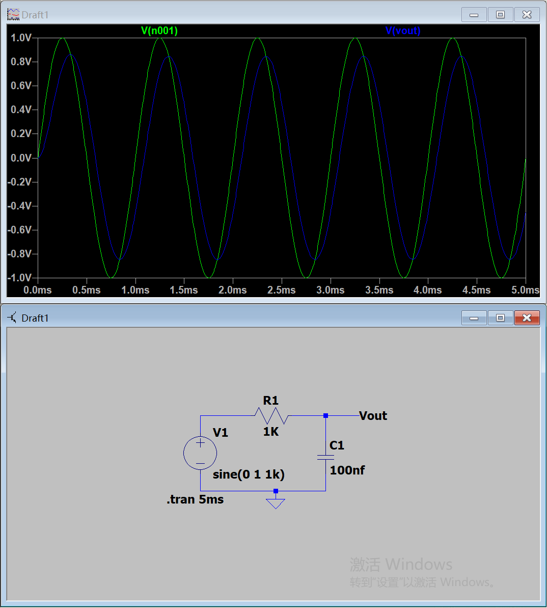
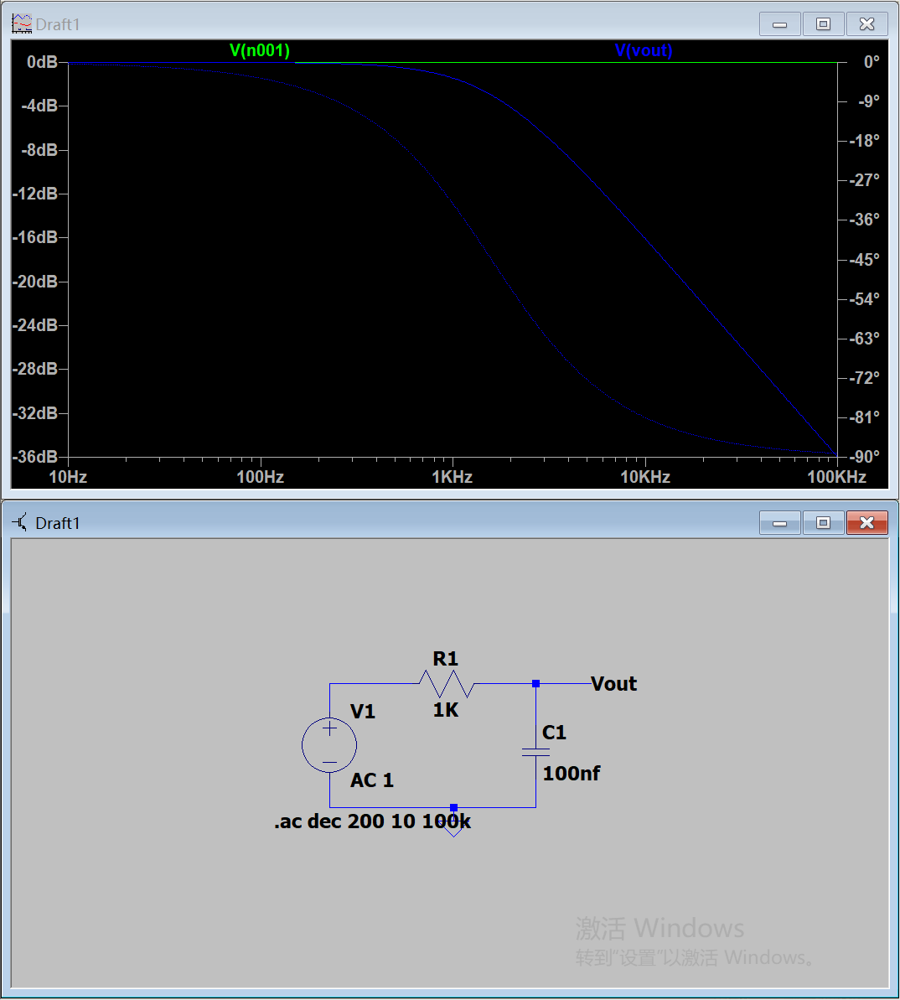
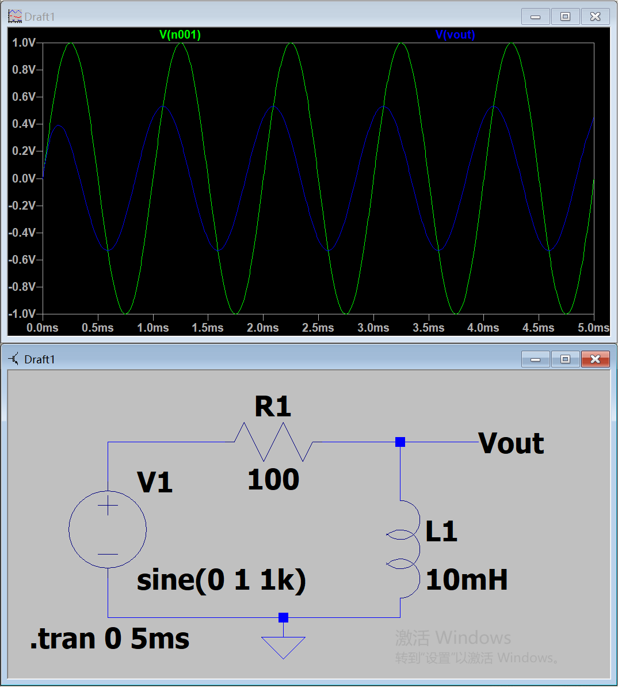
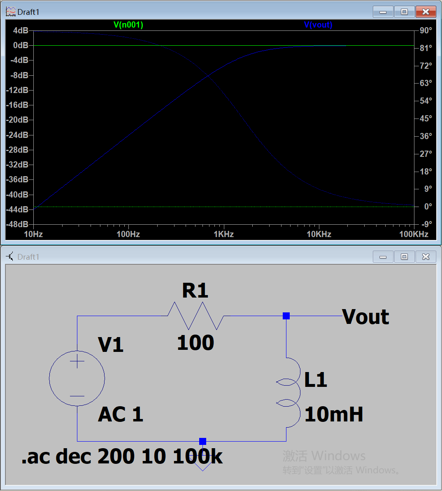
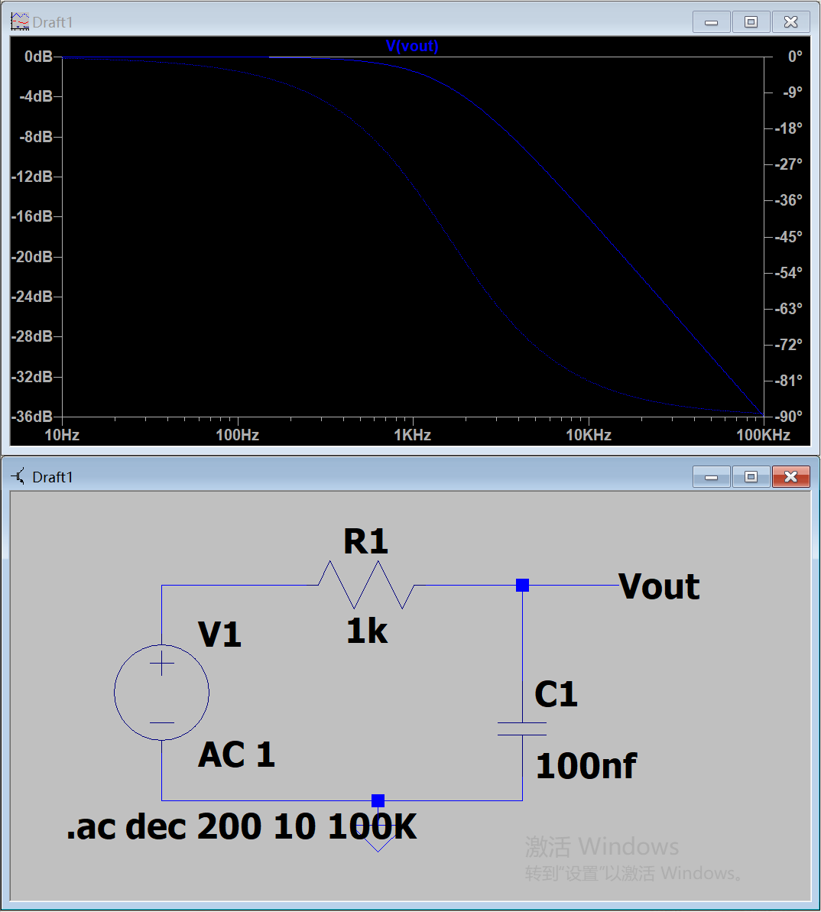
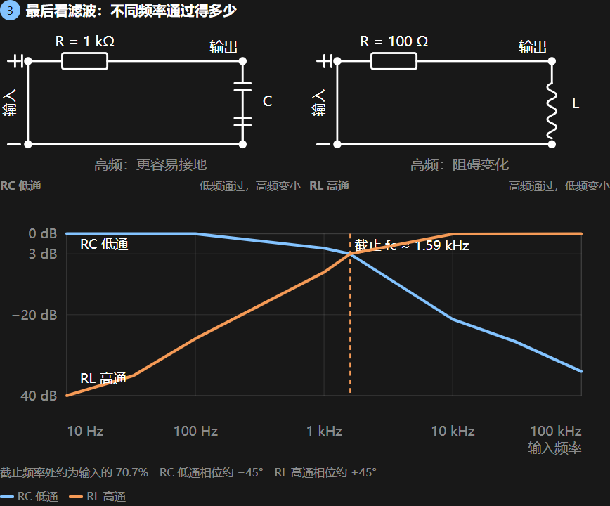
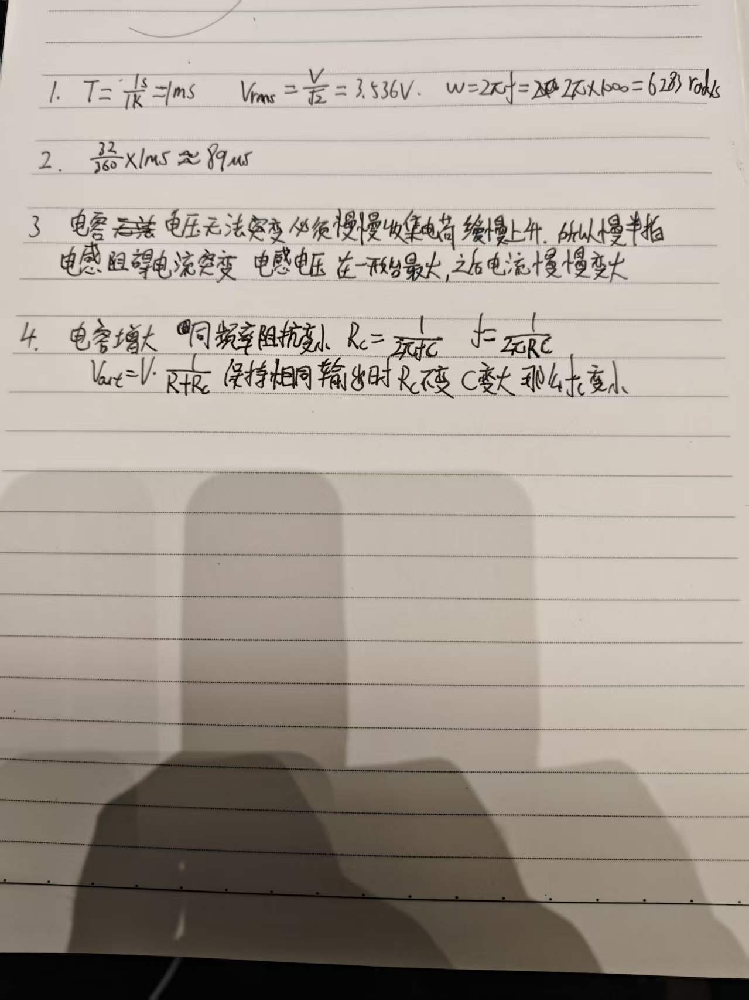

# Day 5｜正弦量、相位、阻抗与 RC/RL 滤波

- 日期：2026-11-05
- 对应阶段：A｜电学第一性原理 + LTspice 入门
- 当日状态：已完成
- 验收成绩：9/10
- 学习方式：概念理解 → 手算预估 → LTspice 瞬态验证 → AC 扫描 → 参数对比 → 闭卷订正

## 一、当天完成内容

| 项目 | 状态 | 结果 |
|---|---|---|
| 正弦量、周期、频率、有效值 | 已完成 | 能完成 1 kHz、5 V 峰值的参数计算 |
| 相位差与时间差 | 已完成 | 32°对应约 89 μs，计算正确 |
| RC 低通瞬态 | 已完成 | 输出峰值约为输入的 84.7%，输出滞后 |
| RC 低通 AC 扫描 | 已完成 | 观察幅度下降与相位趋向 −90° |
| RL 高通瞬态 | 已完成 | 输出峰值约为输入的 53.3%，输出领先 |
| RL 高通 AC 扫描 | 已完成 | 高频通过、低频衰减，相位从正角度趋于 0° |
| 电容参数对比 | 已完成 | 完成 10 nF、100 nF、1 μF 三组扫描 |
| 手写闭卷测验 | 已通过 | 9/10 |

## 二、图形理解

### 1. 正弦波参数

正弦电压可以写成：

```text
v(t) = Vp × sin(ωt + φ)
```

| 符号 | 含义 | 单位 |
|---|---|---|
| Vp | 峰值 | V |
| T | 周期 | s |
| f | 频率 | Hz |
| ω | 角频率 | rad/s |
| φ | 初相位 | rad 或 ° |

频率表示一秒内重复多少次。频率越高，周期越短：

```text
T = 1 / f
ω = 2πf
```

对于纯正弦波，有效值表示与它产生相同电阻发热功率的直流电压：

```text
Vrms = Vp / √2
```

5 V 峰值、1 kHz 正弦波的计算结果：

```text
T = 1 / 1000 = 1 ms
Vrms = 5 / √2 ≈ 3.536 V
ω = 2π × 1000 ≈ 6283 rad/s
```

有效值不是峰值，也不是从正峰到负峰的总幅度。

### 2. 相位差

两个同频率正弦波到达同一波峰的时间不同，就存在相位差。相位差与时间差的关系为：

```text
Δφ / 360° = Δt / T
```

输出经过 32°才达到与输入相同的位置，输入周期为 1 ms，则：

```text
Δt = 32 / 360 × 1 ms ≈ 89 μs
```

判断方向时：

- 输出波峰晚于输入：输出滞后，相位为负；
- 输出波峰早于输入：输出领先，相位为正。

## 三、RC 低通

### 1. 物理过程

电路中电阻串联、电容接地，输出取自电容两端。电容电压不能瞬间改变，只能通过充放电逐渐靠近新的电压，因此输出跟随输入变化得更慢。

高频时，电容对交变信号的阻抗较小，输出节点更容易随高频信号向地摆动，所以高频分量被削弱。

### 2. 阻抗与传递函数

```text
ZC = 1 / (jωC)
```

RC 低通传递函数：

```text
H(jω) = 1 / (1 + jωRC)
```

截止频率：

```text
fc = 1 / (2πRC)
```

使用 R = 1 kΩ、C = 100 nF：

```text
fc = 1 / (2π × 1000 × 100 × 10⁻⁹)
   ≈ 1592 Hz
```

截止频率处应记忆为：

```text
|H(fc)| = 1 / √2 ≈ 0.707
20log10(0.707) ≈ -3 dB
```

RC 低通在截止频率处的相位约为 **−45°**。截止频率并不是“完全停止”，只是幅度下降到约 70.7%。

### 3. 瞬态仿真



参数：

```text
V1：SINE(0 1 1k)
R1：1 kΩ
C1：100 nF
仿真：0～5 ms
```

1 kHz 时理论结果：

```text
输出幅度比 = 0.8467
输出相位 = -32.14°
延迟时间 ≈ 89 μs
```

仿真中输出峰值约为 0.847 V，并明显晚于输入波峰。

源文件：[day05-rc-lowpass-transient.asc](simulations/day05-rc-lowpass-transient.asc)

### 4. AC 扫描



AC 扫描设置：

```text
V1：AC 1
.ac dec 200 10 100k
```

蓝色曲线包含幅度与相位两种信息：幅度看左轴 dB，相位看右轴角度。

观察结果：

- 低频接近 0 dB；
- 高频幅度持续下降；
- 相位从接近 0°逐渐趋向 −90°；
- 约 1592 Hz 处幅度约 −3 dB，相位约 −45°。

源文件：[day05-rc-lowpass-ac.asc](simulations/day05-rc-lowpass-ac.asc)

## 四、RL 高通

### 1. 物理过程

电阻串联、电感接地，输出取自电感两端。电感会阻碍电流变化，电感电压与电流变化率有关：

```text
vL = L × di/dt
```

低频时，电感阻抗较小，更接近短路，输出节点接近地；高频时，电感阻抗增大，输出更接近输入。因此电路允许高频通过、削弱低频。

### 2. 阻抗与截止频率

```text
ZL = jωL
H(jω) = jωL / (R + jωL)
fc = R / (2πL)
```

使用 R = 100 Ω、L = 10 mH：

```text
fc = 100 / (2π × 0.01)
   ≈ 1592 Hz
```

该电路与前面的 RC 低通具有相同截止频率，但频率选择方向相反。

### 3. 瞬态仿真



参数：

```text
V1：SINE(0 1 1k)
R1：100 Ω
L1：10 mH
输出取自 L1
仿真：0～5 ms
```

1 kHz 时理论结果：

```text
输出幅度比 ≈ 0.533
输出相位 ≈ +57.9°
输出领先时间 ≈ 161 μs
```

仿真输出峰值约为 0.533 V，输出波峰早于输入，和理论一致。

源文件：[day05-rl-highpass-transient.asc](simulations/day05-rl-highpass-transient.asc)

### 4. AC 扫描



观察结果：

- 10 Hz 时衰减约 44 dB，相位接近 +90°；
- 频率升高后幅度逐渐恢复到 0 dB；
- 高频时相位逐渐回到 0°；
- 约 1592 Hz 处幅度约 −3 dB，相位约 +45°。

源文件：[day05-rl-highpass-ac.asc](simulations/day05-rl-highpass-ac.asc)

## 五、电容参数对比

保持 R = 1 kΩ，只改变电容，观察截止频率变化。

| 电容 | 截止频率 | 1 kHz 时输出幅度 | 1 kHz 时相位 |
|---|---:|---:|---:|
| 10 nF | 15.9 kHz | 约 0.998 | 约 −3.6° |
| 100 nF | 1.59 kHz | 约 0.847 | 约 −32.1° |
| 1 μF | 159 Hz | 约 0.158 | 约 −81.0° |

### 10 nF


源文件：[day05-rc-10nf-ac.asc](simulations/day05-rc-10nf-ac.asc)

### 100 nF



源文件：[day05-rc-100nf-ac.asc](simulations/day05-rc-100nf-ac.asc)

### 1 μF


源文件：[day05-rc-1uf-ac.asc](simulations/day05-rc-1uf-ac.asc)

三组结果共同说明：

```text
C 增大
→ 同频率下 ZC 减小
→ RC 低通转折频率降低
→ 响应曲线整体向左移动
```



## 六、闭卷测验与订正



成绩：9/10。

### 第 1 题：正确

```text
T = 1 / 1 kHz = 1 ms
Vrms = 5 V / √2 ≈ 3.536 V
ω = 2π × 1 kHz ≈ 6283 rad/s
```

### 第 2 题：正确

```text
32 / 360 × 1 ms ≈ 89 μs
```

### 第 3 题：核心正确，需要补充交流相位关系

原答案已经抓住“电容电压不能突变”和“电感阻碍电流变化”，订正如下：

> RC 低通中，电容只能逐渐充放电，所以输出波峰晚于输入，输出滞后。RL 高通的输出取自电感，电感电压与电流变化率有关；电感电流不能突变，电感电压在电流变化较快时达到峰值，因此输出电压领先输入。

### 第 4 题：结论正确，表达式需要整理

```text
1. 固定频率时，C 越大，ZC = 1/(ωC) 越小；
2. RC 低通中输出分压更小，高频更容易被削弱；
3. fc = 1 / (2πRC)，所以 C 增大时 fc 降低。
```

“某一频率下的阻抗变化”与“整个低通曲线的截止频率位置”是一组相关但不同的概念。

## 七、仿真结论

1. 频率越高，正弦波的周期越短。
2. 正弦波有效值不是峰值，5 V 峰值约为 3.536 V 有效值。
3. RC 低通输出幅度下降并滞后，RL 高通输出幅度恢复并领先。
4. 两种滤波器的截止点都约为 0.707 幅度和 3 dB 衰减。
5. 电容增大使 RC 截止频率降低，AC 曲线向左移动。
6. AC 图中同色曲线可以分别表示幅度和相位，需要结合左右坐标轴阅读。

## 八、当日结论

Day 5 已完成正弦量、有效值、相位、阻抗、RC/RL 频率响应、四组瞬态与 AC 仿真、三组电容参数对比和闭卷测验。

已能：

- 根据频率计算周期与角频率；
- 根据相位差计算波形时间差；
- 区分输出滞后与领先；
- 解释电容和电感在不同频率下的阻抗趋势；
- 根据 AC 曲线判断低通与高通；
- 使用 LTspice 的瞬态、AC 扫描和参数对比验证理论结果；
- 解释电容增大为什么使截止频率降低。

下一日主题：阶段 A 综合练习、仪表与元件初识、闭卷验收。
