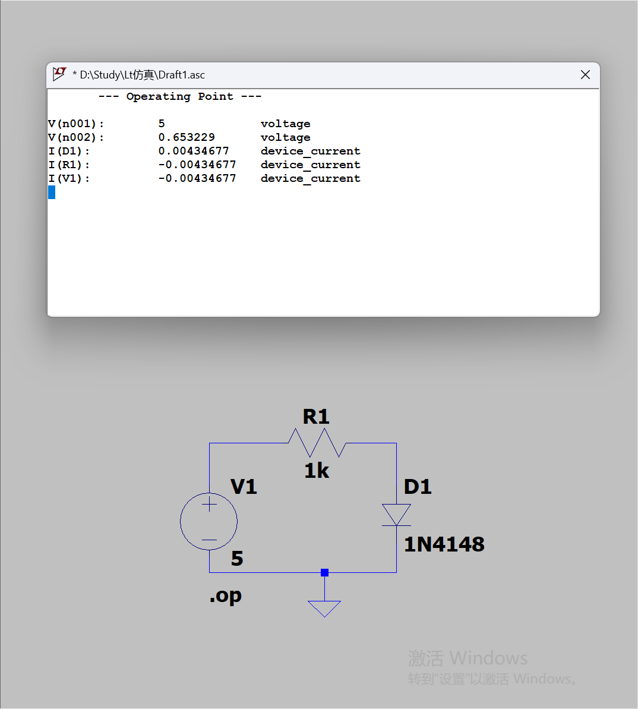
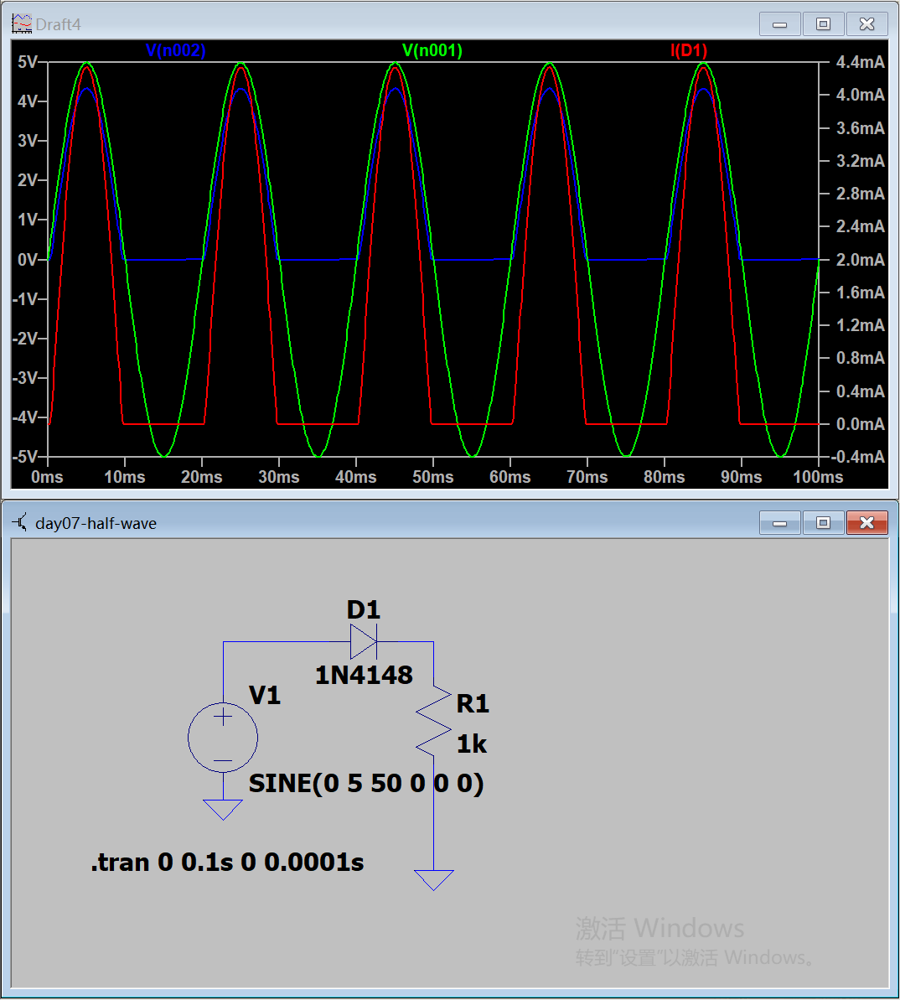
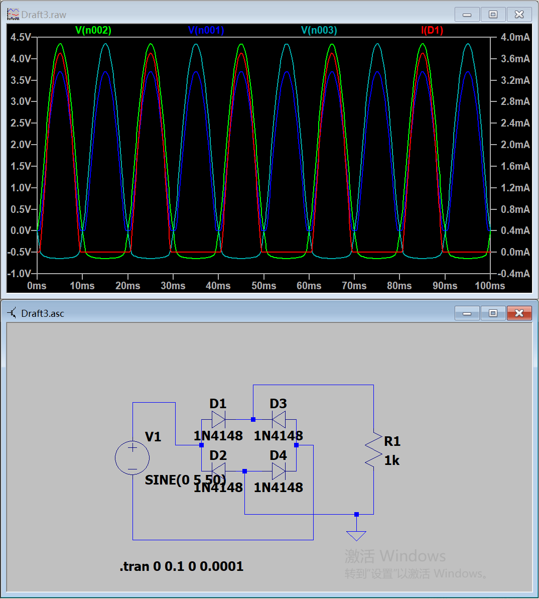

# Day 7｜二极管、整流与肖特基

- 日期：2026-11-05～2026-11-06
- 对应阶段：B｜模拟器件、MOS 与驱动
- 仿真与资料：已完成
- 测验：原始约 4.5/10，订正内容已完整记录，按要求未重测
- 学习边界：本日不包含戴维南定理

## 一、当天完成内容

| 项目 | 状态 | 结果 |
|---|---|---|
| PN结与二极管方向 | 已完成 | 正偏导通、反偏截止 |
| 二极管正向导通仿真 | 已完成 | VF≈0.653 V、I≈4.347 mA |
| 半波整流仿真 | 已完成 | 峰值约4.3 V，50 Hz输出 |
| 桥式整流仿真 | 已完成 | 峰值约3.7 V，100 Hz输出 |
| 1N4148 Datasheet | 已完成 | 最大额定、VF、IR、Ct、trr |
| SS34 Datasheet | 已完成 | VRRM、IF、VF、IR、热参数 |
| 测验订正 | 已完成 | 订正答案写入本记录 |

## 二、二极管基本方向

- 三角形一侧是阳极；
- 竖线一侧是阴极；
- 正向电流从阳极流向阴极；
- 正向偏置时耗尽区变窄；
- 反向偏置时耗尽区变宽。

常用近似：

```text
硅二极管：VF ≈ 0.6～0.8 V
肖特基二极管：VF ≈ 0.3～0.5 V
```

具体压降必须查看型号 Datasheet 和对应测试电流。

## 三、正向导通仿真

电路：

- V1 = 5 V；
- R1 = 1 kΩ；
- D1 = 1N4148；
- 二极管阴极接地；
- 使用 `.op`。

结果：

```text
V(n001) = 5 V
V(n002) = 0.653229 V
I(D1) = 4.34677 mA
```

计算：

```text
I = (5 - 0.653229) / 1 kΩ
  ≈ 4.347 mA
```

二极管功率：

```text
PD = VF × IF
   = 0.653 V × 4.347 mA
   ≈ 2.84 mW
```



源文件：[day07-diode-forward-op.asc](simulations/day07-diode-forward-op.asc)

## 四、半波整流仿真

交流源：

```text
SINE(0 5 50 0 0 0)
```

含义：

- 直流偏置：0 V；
- 峰值幅度：5 V；
- 频率：50 Hz；
- 延迟：0 s；
- 阻尼：0；
- 相位：0°。

电路：

- D1 = 1N4148；
- R1 = 1 kΩ；
- 仿真时间：0～0.1 s；
- 最大步长：0.1 ms。

结果：

- 正半周二极管导通；
- 负半周二极管截止；
- 输出峰值约4.3 V；
- 负载峰值电流约4.3～4.4 mA；
- 输出脉动频率仍为50 Hz。

半波整流每个输入周期只有一个输出脉冲，因此输出频率与输入频率相同。



源文件：[day07-half-wave.asc](simulations/day07-half-wave.asc)

## 五、桥式整流仿真

桥式整流使用四只1N4148：

- 交流源接桥的左侧和右侧输入端；
- 直流正输出在桥的上端；
- 直流负输出在桥的下端；
- 负载连接上下两个直流输出端；
- R1 = 1 kΩ；
- 交流源峰值5 V、频率50 Hz。

正半周D1、D4导通；负半周D2、D3导通。

输出峰值：

```text
Vout,pk = Vin,pk - 2VF
        ≈ 5 - 2 × 0.65
        ≈ 3.7 V
```

不能达到5 V的原因：

- 每个半周都有两只二极管串联；
- 每只1N4148约有0.6～0.7 V正向压降；
- 两个正向压降合计约1.3～1.4 V；
- 输出峰值因此约为3.6～3.7 V。

输出脉动频率：

```text
50 Hz输入 × 2 = 100 Hz
```



源文件：[day07-bridge-rectifier.asc](simulations/day07-bridge-rectifier.asc)

## 六、1N4148 参数摘要

厂商：Vishay

```text
VRRM = 100 V
VR = 75 V
IF(AV) = 150 mA
IF = 300 mA
IFRM = 500 mA
IFSM = 2 A，tp = 1 μs
VF ≤ 1.0 V，IF = 10 mA
Ct = 4 pF
trr = 4～8 ns，取决于测试条件
TJ(max) = 175 ℃
```

完整参数卡：

[1N4148 Datasheet 参数卡](datasheet-card-1N4148.md)

## 七、SS34 参数摘要

厂商：onsemi，原 Fairchild 产品线

```text
VRRM = 40 V
IF(AV) = 3.0 A，TA = 75 ℃
IFSM = 100 A，8.3 ms单次半正弦波
VF = 0.5 V，IF = 3.0 A、TA = 25 ℃
IR = 0.5 mA，VR = 40 V、TA = 25 ℃
IR = 20 mA，VR = 40 V、TA = 100 ℃
TJ = -55 ℃～+150 ℃
封装：SMC / DO-214AB
```

SS34是肖特基二极管，没有普通PN结二极管意义下的长少数载流子反向恢复时间。高频应用仍需要关注结电容、封装寄生和反向漏电。

完整参数卡：

[SS34 Datasheet 参数卡](datasheet-card-SS34.md)

## 八、测验原始结果与订正

原始得分：约4.5/10。

| 题号 | 原始结果 |
|---|---|
| 1 | 正确 |
| 2 | 电压、电流正确，功率数量级错误 |
| 3 | 峰值正确，输出频率错误 |
| 4 | 输出频率错误 |
| 5 | 正确 |
| 6 | 正确 |
| 7 | 部分正确 |
| 8 | 未完成 |
| 9 | 未完成 |
| 10 | 未完成 |

### 第2题

```text
二极管功率 = 0.7 V × 11.3 mA
           = 7.91 mW
```

### 第3、4题

半波整流输出频率与输入频率相同：

```text
50 Hz输入 → 50 Hz输出
60 Hz输入 → 60 Hz输出
```

全波桥式整流输出脉动频率是输入的两倍。

### 第7题

| 参数 | 含义 |
|---|---|
| IF = 300 mA | 连续正向电流 |
| IF(AV) = 150 mA | 平均正向电流 |
| IFRM = 500 mA | 重复峰值正向电流 |
| IFSM = 2 A | 1 μs非重复浪涌电流 |

### 第8题

| 参数 | 1N4148 | SS34 |
|---|---|---|
| VRRM | 100 V | 40 V |
| IF(AV) | 150 mA | 3 A |
| VF | ≤1 V @10 mA | 0.5 V @3 A |
| 主要用途 | 小信号、快速开关 | 低压整流、续流、反接保护 |

### 第9题

`trr`：反向电流从建立到恢复到规定小值所需的时间。

`Qrr`：反向恢复期间被抽走的储存电荷。

普通PN结正向导通时存在少数载流子储存，反向切换后需要时间抽走这些电荷。

### 第10题

肖特基二极管主要依靠多数载流子导电，没有明显的少数载流子储存，因此通常没有普通PN结意义下的长反向恢复过程。

高频应用仍需关注：

- 结电容；
- 封装电感；
- ESR；
- 反向漏电；
- dV/dt；
- 散热。

## 九、当日结论

已完成二极管方向、正向压降、半波整流、桥式整流、两只二极管Datasheet和测验订正。

需要保留的核心判断：

- 半波整流输出频率等于输入频率；
- 桥式整流输出频率是输入的两倍；
- 硅桥输出峰值要减去两个二极管压降；
- 1N4148适合小信号，不适合数安培整流；
- SS34适合低压大电流整流，但反向耐压和漏电需要关注；
- `trr`、`Qrr`、VF 和 IR 都必须结合测试条件理解。

下一日主题：BJT、MOS结构、工作区与导通条件。
