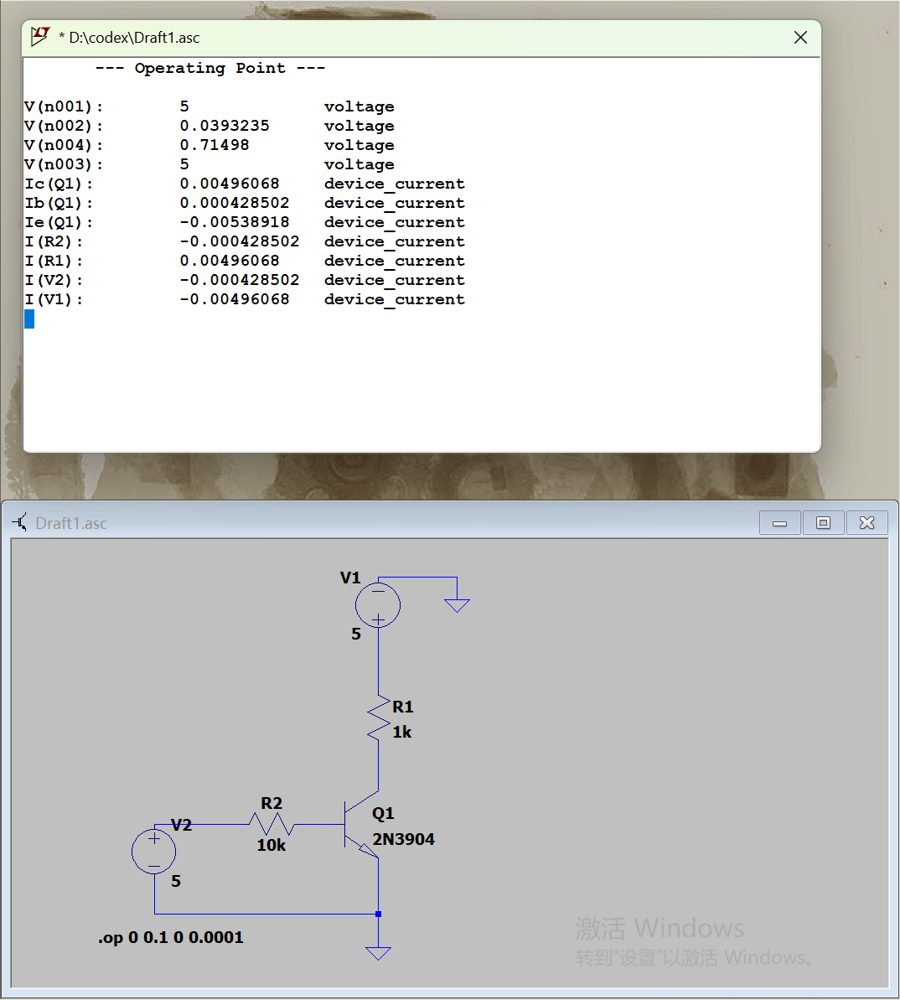
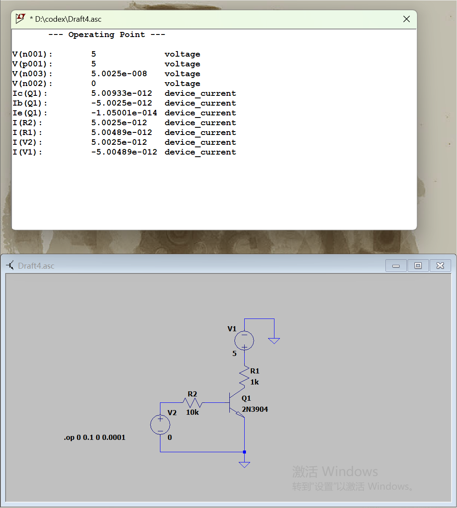
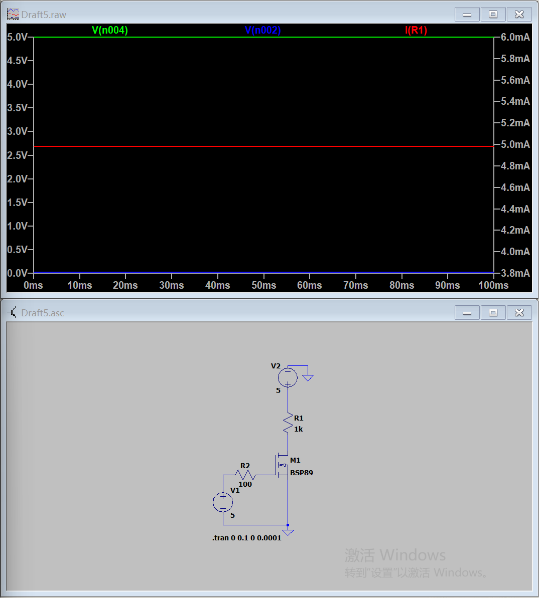
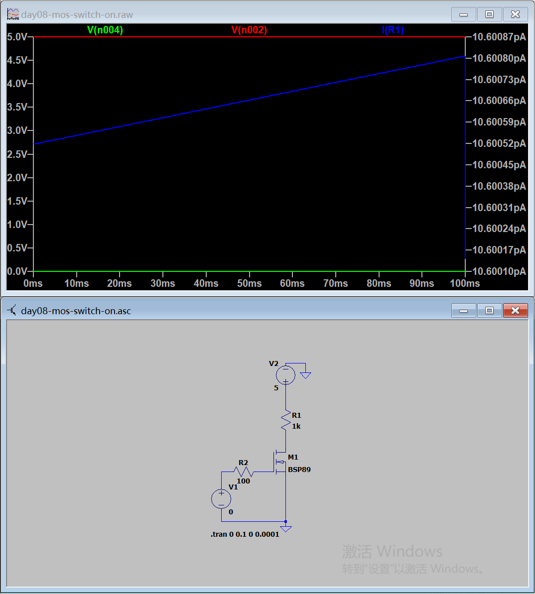
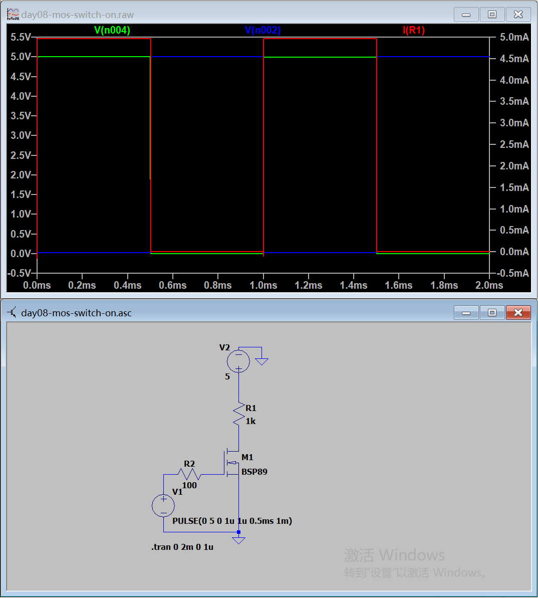

# Day 8｜BJT、MOS 与低边开关

- 日期：2026-11-06
- 对应阶段：B｜模拟器件、MOS 与驱动
- 已完成：理论、NPN与MOS开关仿真、Datasheet参数卡
- 待完成：Day 8 闭卷测验
- 学习边界：本日不包含戴维南定理

## 一、当天完成内容

| 项目 | 状态 | 结果 |
|---|---|---|
| NPN结构与工作区 | 已完成 | 能区分截止、放大和饱和 |
| N-MOS结构与工作区 | 已完成 | 能区分截止、可变电阻区和恒流区 |
| NPN导通仿真 | 已完成 | 三极管进入饱和 |
| NPN截止仿真 | 已完成 | 集电极电流接近0 |
| N-MOS导通仿真 | 已完成 | 漏极接近0 V，负载约5 mA |
| N-MOS截止仿真 | 已完成 | 漏极接近5 V，漏电为pA级 |
| N-MOS脉冲开关 | 已完成 | 输入高低电平控制负载通断 |
| 2N3904 Datasheet | 已完成 | 额定值、hFE、VCE(sat)、热参数 |
| BSP89 Datasheet | 已完成 | 主要参数已记录，部分条件待核对 |

## 二、低边开关

低边开关把控制器件放在负载和地之间：

```text
电源正极 → 负载 → 开关器件 → 地
```

优点：

- 控制端以地为参考；
- 适合使用NPN或N沟道MOSFET；
- 驱动电路结构简单。

本日使用的控制器件：

- NPN：2N3904；
- N-MOS：BSP89。

## 三、NPN三极管

### 三个工作区

| 工作区 | 条件 | 特点 |
|---|---|---|
| 截止 | 发射结未正偏 | IC≈0 |
| 放大 | 发射结正偏、集电结反偏 | IC≈βIB |
| 饱和 | 发射结和集电结均正偏 | VCE较小，开关导通 |

开关应用主要使用截止和饱和。

### 基极电流

```text
IB ≈ (VIN - VBE) / RB
```

本实验参数：

```text
VCC = 5 V
RC = 1 kΩ
RB = 10 kΩ
VIN = 5 V
```

### 导通结果

```text
VBE = 0.71498 V
VCE = 0.0393235 V
IB = 0.428502 mA
IC = 4.96068 mA
IE ≈ 5.38918 mA
```

计算：

```text
IC / IB
= 4.96068 / 0.428502
≈ 11.58
```

实际比值远低于2N3904的小信号hFE，说明基极被充分驱动，三极管进入饱和。



源文件：[day08-bjt-switch-on.asc](simulations/day08-bjt-switch-on.asc)

### 截止结果

```text
VBE ≈ 0 V
IC ≈ 5 pA
VCE ≈ 5 V
```

pA级电流来自仿真模型泄漏，可视为0。



源文件：[day08-bjt-switch-off.asc](simulations/day08-bjt-switch-off.asc)

## 四、N沟道增强型MOSFET

### 工作区

| 工作区 | 条件 | 特点 |
|---|---|---|
| 截止 | VGS < VGS(th) | ID≈0 |
| 可变电阻区 | 足够大的VGS、较小VDS | 可作开关 |
| 恒流区 | 较大VDS | ID受VGS控制 |

必须区分：

```text
VGS超过阈值：沟道开始形成
充分导通：VGS更高，RDS(on)足够低
```

### MOS导通结果

仿真参数：

```text
VDD = 5 V
RD = 1 kΩ
RG = 100 Ω
VGS = 5 V
```

结果：

```text
VDS≈0 V
ID≈5 mA
|I(R1)|≈5 mA
```



源文件：[day08-mos-switch-on.asc](simulations/day08-mos-switch-on.asc)

### MOS截止结果

把VGS改为0 V：

```text
VDS≈5 V
ID≈10.6 pA
```

pA级电流可视为0。



源文件：[day08-mos-switch-off.asc](simulations/day08-mos-switch-off.asc)

原始工程没有单独保存截止状态，本工程根据已验证的截止工作点补齐。

## 五、MOS脉冲开关

栅极脉冲：

```text
PULSE(0 5 0 1u 1u 0.5ms 1m)
```

仿真：

```text
0～2 ms
最大步长1 μs
```

结果：

- VGS为5 V时，MOS导通；
- VDS接近0 V；
- 负载电流约4.7 mA；
- VGS为0 V时，MOS截止；
- VDS接近5 V；
- 负载电流接近0。

输入和输出相位相反，这是低边开关的正常现象。



源文件：[day08-mos-pulse.asc](simulations/day08-mos-pulse.asc)

## 六、BJT与MOS对比

| 项目 | 2N3904 NPN | BSP89 N-MOS |
|---|---|---|
| 控制量 | 基极电流 | 栅源电压 |
| 稳态控制电流 | 需要基极电流 | 基本无栅极电流 |
| 导通条件 | 基极充分过驱动，进入饱和 | VGS足够高，VDS较小 |
| 主要导通损耗 | VCE(sat)×IC | ID²×RDS(on) |
| 低边开关 | 发射极接地 | 源极接地 |

## 七、2N3904参数摘要

厂商：onsemi

```text
VCEO = 40 V
VCBO = 60 V
VEBO = 6 V
IC = 200 mA
Ptot = 625 mW，TA=25℃
RθJA = 200℃/W
hFE = 100～300，IC=10mA、VCE=1V
VCE(sat) ≤0.2 V，IC=10mA、IB=1mA
VCE(sat) ≤0.3 V，IC=50mA、IB=5mA
TJ(max) = 150℃
封装：TO-92
```

完整参数卡：

[2N3904 Datasheet 参数卡](datasheet-card-2N3904.md)

## 八、BSP89参数摘要

厂商：Infineon

```text
VDS(max) = 240 V
VGS(max) = ±20 V
ID = 350 mA
VGS(th) = 0.8～2.0 V
RDS(on) = 4 Ω典型、6 Ω最大
Qg = 4.3 nC典型
Ciss = 80 pF
Ptot ≈1.5～1.8 W
RθJA ≈88.3～115 K/W
TJ = -55～150℃
封装：SOT-223
```

重要限制：

- RDS(on)必须注明对应的VGS和ID；
- VGS(th)只是开始导通的门槛；
- 当前仿真VGS=5 V，不能直接把VGS=10 V条件下的6 Ω上限当作5 V时的实际值；
- 当前资料没有明确给出的参数不进行猜测。

完整参数卡：

[BSP89 Datasheet 参数卡](datasheet-card-BSP89.md)

## 九、工程安全

- 感性负载必须提供续流路径；
- 不能突然断开导通中的继电器或电机线圈；
- MOS栅极不能悬空；
- BJT基极必须通过限流电阻驱动；
- MOSFET作开关时，驱动电压必须足以达到设计要求的RDS(on)；
- 热设计必须结合最大电流、RDS(on)或VCE(sat)以及环境温度。

## 十、当前结论

本日已经理解：

- NPN和N-MOS都可以作为低边开关；
- NPN由基极电流控制；
- N-MOS由VGS控制；
- BJT开关应进入饱和；
- MOSFET开关应进入VDS较小的可变电阻区；
- 控制输入高低电平能够控制负载通断。

下一步：

1. 完成Day 8的10题闭卷测验；
2. 进入Day 9，学习MOS的RDS(on)、Qg、栅极驱动、开关速度和损耗。
